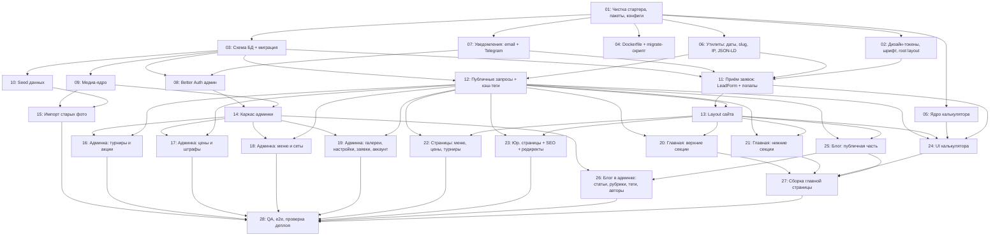

# Пирамида 74 — переписывание сайта на Next.js: админка, калькулятор, блог

## Overview

Старый PHP-сайт бильярдного клуба «Пирамида» (Челябинск, `piramida-billiard-74.ru`) переносится на Next.js 16 на основе стартера из этого репозитория. Визуальный дизайн сохраняется, вёрстка становится нормально адаптивной, мёртвый CSS и JS не переносятся.

Что добавляется:
- админка для 1–2 администраторов: турниры, цены аренды, меню, банкетные сеты, акции, галереи, заявки, блог, настройки;
- калькулятор стоимости заказа на N гостей с отправкой заявки в клуб;
- блог по образцу проекта billiard-darom.

Деплой — Docker-контейнер на VDS с Dokploy, данные в Postgres 18, загруженные файлы в Docker volume.

## Quick Links

- [Requirements](./requirements.md) — требования и критерии приёмки
- [Action Required](./action-required.md) — ручные шаги владельца
- [PLAN.md](./PLAN.md) — исходный план. **Раздел 16 в нём имеет приоритет**
- [data/res-transcription.md](./data/res-transcription.md) — транскрипция прайсов, меню и календаря из `res/*.jpg`
- [data/legacy-notes.md](./data/legacy-notes.md) — факты о старом сайте (`C:\OSPanel\home\74.loc`)

## Dependency Graph

## Waves

| Wave | Tasks | Description |
|------|-------|-------------|
| 1 | 01 | Чистка стартера, установка **всех** пакетов и shadcn-компонентов, конфиги |
| 2 | 02–07 | Фундамент: токены, схема БД, Docker, ядро калькулятора, утилиты, уведомления |
| 3 | 08–12 | Auth, медиа, seed, приём заявок, публичные запросы |
| 4 | 13–15 | Layout сайта, каркас админки, импорт старых фото |
| 5 | 16–25 | Разделы админки, секции и страницы сайта, калькулятор, блог |
| 6 | 26–27 | Админка блога, сборка главной |
| 7 | 28 | QA, e2e, Lighthouse, security-review, проверка Docker-сборки |

## Владение общими файлами (правило параллельной работы)

| Файл / область | Владелец |
|---|---|
| `package.json`, `pnpm-lock.yaml`, `components.json`, `src/components/ui/*`, `next.config.ts`, `env.example`, `src/lib/env.ts` | 01; ещё только 23 (`redirects()` в `next.config.ts`) |
| `src/app/globals.css`, `DESIGN.md`, `src/app/layout.tsx` | 02 |
| `src/lib/schema/**`, `drizzle/**`, `drizzle.config.ts` | 03 (больше никто не меняет схему) |
| `src/lib/auth.ts`, `src/lib/auth-client.ts`, `src/lib/session.ts`, `src/proxy.ts` | 08 |
| `src/lib/queries/**`, `src/lib/cache-tags.ts` | 12; ещё 25 (только `src/lib/queries/blog.ts`) |
| `src/app/(site)/layout.tsx` | 13 |
| `src/app/(site)/page.tsx` | 27 |
| `src/app/(admin)/admin/layout.tsx`, `src/components/admin/*` (общие), `src/lib/admin/*`, `/admin/media`, `/api/admin/media` | 14 |
| `pnpm-workspace.yaml`, `.nvmrc`, `eslint.config.mjs`, `vitest.config.ts`, `playwright.config.ts`, `e2e/health.spec.ts` | 01 |
| `src/lib/db.ts` | 03 |
| `.gitattributes`, `scripts/migrate.ts` | 04 |
| `src/lib/calculator/**` (в т. ч. `catalog-mapper.ts`) | 05 |
| `src/assets/fonts/**`, `public/icons/*`, `src/app/favicon.ico`, `src/app/manifest.ts` | 02 |
| `public/images/logo.{png,webp}`, `public/images/tournament-default.webp`, `public/images/work-steps-bg.webp` | 15 |
| `public/images/popup-bg.webp` | 11 |
| `public/images/home/*` | 21 |

Межзадачные имена и сигнатуры — в [data/contracts.md](./data/contracts.md); при расхождении с task-файлом прав `contracts.md`.

Новые зависимости после задачи 01 не ставятся. Если пакета не хватает — агент сообщает об этом, а не ставит сам.

## Task Status

### Wave 1
- [x] [task-01-starter-cleanup-deps](./tasks/task-01-starter-cleanup-deps.md) — Чистка стартера, пакеты, shadcn, конфиги, тестовый тулинг

### Wave 2
- [x] [task-02-design-tokens-layout](./tasks/task-02-design-tokens-layout.md) — Токены Tailwind, Onest, DESIGN.md, root layout, фавиконы
- [x] [task-03-db-schema](./tasks/task-03-db-schema.md) — Полная схема Drizzle + одна миграция
- [x] [task-04-docker-deploy](./tasks/task-04-docker-deploy.md) — Dockerfile, entrypoint, бандл migrate
- [x] [task-05-calculator-core](./tasks/task-05-calculator-core.md) — Чистые функции калькулятора + Vitest
- [x] [task-06-shared-utils](./tasks/task-06-shared-utils.md) — Даты (Екатеринбург), slug, IP, JSON-LD
- [x] [task-07-notify-lib](./tasks/task-07-notify-lib.md) — Email (nodemailer) и Telegram

### Wave 3
- [x] [task-08-auth-admin](./tasks/task-08-auth-admin.md) — Better Auth: админ, 2FA, rate limit, login, seed-admin, proxy
- [x] [task-09-media-core](./tasks/task-09-media-core.md) — Хранилище в volume, sharp, отдача `/media`, `<Picture>`
- [x] [task-10-seed-data](./tasks/task-10-seed-data.md) — Seed: турниры, тарифы, акции, меню, штрафы, настройки
- [x] [task-11-lead-capture](./tasks/task-11-lead-capture.md) — LeadForm, попапы, submitLead, согласие, `/spasibo`
- [x] [task-12-public-queries](./tasks/task-12-public-queries.md) — Кэшируемые запросы и теги

### Wave 4
- [x] [task-13-site-layout](./tasks/task-13-site-layout.md) — Шапка, футер, cookie-баннер, Метрика, 404
- [x] [task-14-admin-shell](./tasks/task-14-admin-shell.md) — Каркас админки, общие компоненты, загрузка, аудит
- [x] [task-15-legacy-images-import](./tasks/task-15-legacy-images-import.md) — Импорт фото со старого сайта

### Wave 5
- [x] [task-16-admin-tournaments-promotions](./tasks/task-16-admin-tournaments-promotions.md) — Админка: турниры, серии, акции
- [x] [task-17-admin-pricing](./tasks/task-17-admin-pricing.md) — Админка: залы, тарифы, доп. услуги, штрафы
- [x] [task-18-admin-menu-sets](./tasks/task-18-admin-menu-sets.md) — Админка: меню, варианты, сетки цен, сеты
- [x] [task-19-admin-galleries-settings-leads](./tasks/task-19-admin-galleries-settings-leads.md) — Админка: галереи, услуги, настройки, заявки, аккаунт, cron
- [x] [task-20-home-sections-top](./tasks/task-20-home-sections-top.md) — Hero, акции, услуги, календарь, бар, прайс
- [x] [task-21-home-sections-bottom](./tasks/task-21-home-sections-bottom.md) — О клубе, бронирование, CTA, контакты и карта
- [x] [task-22-pages-menu-prices-tournaments](./tasks/task-22-pages-menu-prices-tournaments.md) — `/menu`, `/prices`, `/tournaments`
- [x] [task-23-legal-seo-redirects](./tasks/task-23-legal-seo-redirects.md) — `/politika`, `/soglasie`, sitemap, robots, JSON-LD, редиректы
- [x] [task-24-calculator-ui](./tasks/task-24-calculator-ui.md) — `/calculator`, nuqs, отправка, блок для главной
- [x] [task-25-blog-public](./tasks/task-25-blog-public.md) — Блог: страницы, RSS, OG, тизер

### Wave 6
- [x] [task-26-blog-admin](./tasks/task-26-blog-admin.md) — Блог в админке: статьи, рубрики, теги, авторы (медиатека — `/admin/media` из задачи 14)
- [x] [task-27-home-assembly](./tasks/task-27-home-assembly.md) — Сборка `src/app/(site)/page.tsx`

### Wave 7
- [ ] [task-28-qa-verification](./tasks/task-28-qa-verification.md) — Playwright e2e, визуальная сверка, Lighthouse, security, Docker
